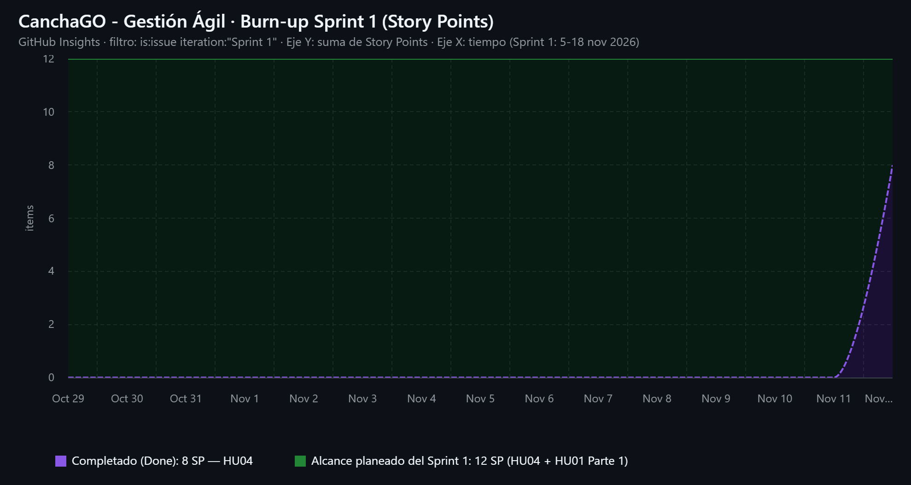

# Informe de Gestión y Productividad - Sprint 1

* **Proyecto:** CanchaGO – Gestión de turnos y control de acceso en canchas sintéticas
* **Tablero:** GitHub Projects · *CanchaGO - Gestión Ágil* (plantilla *Iterative development*)
* **Asignatura:** Ingeniería de Software I – Universidad Mariana
* **Fecha de corte:** 12 de noviembre de 2026

| Rol | Integrante |
| :--- | :--- |
| Product Owner | Samuel Betancourt |
| Líder Técnico | Jesús Ojeda |
| Desarrolladora | Luisa Salazar |
| Desarrolladora | Karol Estefany Herrera |

## 1. Resumen de la Iteración

* **Sprint Activo:** Sprint 1 (5 al 18 de noviembre de 2026, 2 semanas)
* **Velocidad Planeada:** 12 SP (HU04 = 8 SP + HU01 Parte 1 = 4 SP)
* **Velocidad Lograda (Real):** 8 SP (HU04 completada)
* **Porcentaje de Cumplimiento:** 66,7 %

$$V_{real} = \sum \text{SP de HUs en Done} = 8\ \text{SP}$$

$$\text{Cumplimiento} = \left(\frac{V_{real}}{V_{planeada}}\right) \times 100\% = \left(\frac{8}{12}\right) \times 100\% = 66{,}7\%$$

## 2. Métricas y Seguimiento del Avance

* **Gráfico Burn-up:** gráfico *Burn-up Sprint 1 (Story Points)* de GitHub Insights, con el eje Y como suma del campo **Story Points**, el eje X como tiempo y el filtro `iteration:"Sprint 1"`. El alcance planeado se mantiene en 12 SP y el trabajo completado sube a 8 SP cuando se fusiona el PR #13.



* **Estado del tablero (Current iteration):**

| Columna | Historias | Story Points |
| :--- | :--- | :---: |
| Backlog | — | 0 |
| In progress | #1 HU01 - Consulta de Disponibilidad (Parte 1) | 4 |
| In review | — | 0 |
| Done | #4 HU04 - Configuración de Canchas y Tarifas Dinámicas | 8 |

* **Análisis de Desviaciones:**
  * **Dependencia entre historias:** la HU01 (consulta de disponibilidad) necesita las canchas y tarifas configuradas en la HU04. Por eso el equipo primero terminó e integró la HU04 y dejó la HU01 Parte 1 (motor de disponibilidad) en *In progress*.
  * **Configuración del entorno local:** el comando de la guía `mkdir -p src/controllers src/models src/dao src/views` no funciona en Windows PowerShell. Se reemplazó por `mkdir src/controllers, src/models, src/dao, src/views`. También se configuró la identidad de Git (`git config --global user.email / user.name`) para evitar el error *unable to auto-detect email address*.
  * **Ajuste de la iteración:** GitHub creó el Sprint 1 con 15 días (4–18 nov). Se corrigió a 14 días (5–18 nov) para que coincida con la duración fija de 2 semanas.
  * **Revisión de código:** la HU04 pasó por *In review* antes del merge del PR #13. La revisión se hizo el mismo día, así que no hubo demora en esta etapa.

### Comparación entre iteraciones

| Sprint | Fechas | Velocidad planeada | Velocidad real | Cumplimiento |
| :--- | :--- | :---: | :---: | :---: |
| Sprint 1 | 05/11 – 18/11 | 12 SP | 8 SP (al corte) | 66,7 % |
| Sprint 2 | 19/11 – 02/12 | 10 SP (reajustada) | — | — |
| Sprint 3 | 03/12 – 16/12 | 10 SP (reajustada) | — | — |

## 3. Incremento Entregado (Definition of Done)

| Issue ID | Historia de Usuario | Story Points | Estado Final | Commit / PR de Cierre |
| :--- | :--- | :--- | :--- | :--- |
| #4 | Configuración de Canchas y Tarifas Dinámicas | 8 SP | Done | PR #13 (Merged) · commit `2de32de` |
| #1 | Consulta de Disponibilidad de Canchas (Parte 1) | 4 SP | In Progress | Pendiente (rama `feature/issue-1-...`) |

**Trazabilidad:** la rama `feature/issue-4-configuracion-canchas-tarifas` tiene 6 commits con el formato `feat: [8 SP] ... (#4)`. El PR #13 incluye `Closes #4`, así que al fusionarlo con `main` GitHub cerró el Issue #4 y movió la tarjeta a **Done**.

## 4. Mantenibilidad del Código Fuente

* **Arquitectura:** implementación en 3 capas (`/models`, `/dao`, `/controllers`), más la capa de presentación (`/views`) y el punto de entrada `index.js`.

```
src/
├── models/Cancha.js                 # Modelo (entidad de dominio)
├── dao/CanchaDAO.js                 # Acceso a datos (BD simulada en memoria)
├── controllers/CanchaController.js  # Lógica de negocio + Facade
└── views/CanchaView.js              # Presentación (consola)
index.js                             # Demostración ejecutable
```

* **Patrones Usados:** Facade (`CanchaController.js`) y DAO (`CanchaDAO.js`). La vista solo se comunica con la fachada, y la lógica de negocio no sabe cómo ni dónde se guardan los datos.
* **Principios SOLID (SRP):** cada clase tiene una sola responsabilidad. `Cancha` describe datos, `CanchaDAO` los persiste, `CanchaController` aplica las reglas y `CanchaView` las muestra.
* **Reglas de negocio de la HU04:** tarifas por franja (festivo/domingo > hora pico 18:00–21:59 > tarifa base), cancha habilitada o inhabilitada para la venta, y validación de tarifas (positivas, y hora pico y festivo ≥ tarifa base).
* **Buenas Prácticas:** contratos documentados con JSDoc (`@param`, `@returns`, `@throws`), modularización CommonJS (`module.exports`), constantes con nombre (`HORA_PICO_INICIO`, `HORA_PICO_FIN`) y manejo de errores con mensajes claros.
* **Integración simulada con base de datos:** el arreglo `canchasBD` del DAO hace de persistencia. Para conectar una base de datos real solo hay que cambiar el DAO, sin tocar el controlador ni la vista.
* **Producto funcional:** se ejecuta con `npm start` (o `node index.js`).

## 5. Reajustes para el Sprint 2

* **Factores técnicos que afectaron el desempeño del equipo:**
  * Dependencia de la HU01 respecto a la HU04, lo que obligó a desarrollarlas en secuencia y no en paralelo.
  * Tiempo dedicado a configurar el entorno (Git en PowerShell, estructura de carpetas y GitHub Projects).
  * Primera iteración del equipo con el flujo *rama → PR → merge*, lo que exigió tiempo de aprendizaje.
* **Reajuste de la velocidad estimada para la siguiente iteración:**
  * Con la velocidad real (8 SP) y la planeada (12 SP), la velocidad del Sprint 2 se reajusta a **10 SP**: un valor intermedio mientras se tienen más datos históricos.
  * **Sprint 2 propuesto (9 SP ≤ 10 SP):** HU01 Parte 1 (arrastre, 4 SP) y HU02 Reserva de Cancha con Pago de Anticipo (5 SP).
  * **Impacto en el MVP:** quedan 41 − 8 = 33 SP del MVP. Con V = 10 SP se necesitan ⌈33 / 10⌉ = 4 sprints más, así que el MVP pasa de 4 a **5 sprints (10 semanas)**. La HU01 Parte 2, la HU07 y la HU08 se reprograman para los Sprints 3 y 4, y la HU06 para el Sprint 5.

## 6. Entrega Final del Product Backlog (actualización)

Después del corte del Sprint 1, el equipo completó el resto del Product Backlog siguiendo el mismo flujo de trabajo: una rama por Historia de Usuario, commits con los Story Points y el número del Issue, y un Pull Request con `Closes #n` hacia `main`.

| Orden | Issue | Historia de Usuario | SP | Rama | Estado |
| :-: | :-: | :--- | :-: | :--- | :--- |
| 1 | #4 | Configuración de Canchas y Tarifas Dinámicas | 8 | `feature/issue-4-configuracion-canchas-tarifas` | Done (PR #13) |
| 2 | #1 | Consulta de Disponibilidad de Canchas (arquitectura base web) | 13 (4 + 9) | `feature/issue-1-consulta-disponibilidad` | Done (PR #15) |
| 3 | #2 | Reserva de Cancha con Pago de Anticipo | 5 | `feature/issue-2-reserva-anticipo` | Done (PR #16) |
| 4 | #7 | Registro de Ingreso y Cobro de Saldo Restante | 5 | `feature/issue-7-ingreso-cobro-saldo` | Done (PR #17) |
| 5 | #8 | Registro Manual de Reservas Presenciales o Telefónicas | 5 | `feature/issue-8-reservas-taquilla` | Done (PR #18) |
| 6 | #6 | Reporte y Monitoreo de Recaudos Diarios | 5 | `feature/issue-6-reporte-recaudos` | Done (PR #19) |
| 7 | #3 | Cancelación y Reagendar de Turnos | 3 | `feature/issue-3-cancelar-reagendar` | Done (PR #20) |
| 8 | #9 | Notificaciones Automáticas de Confirmación y Recordatorio | 5 | `feature/issue-9-notificaciones` | Done (PR #21) |
| 9 | #10 | Historial de Reservas y Repetición de Turno Frecuente | 3 | `feature/issue-10-historial-repetir-turno` | Done (PR #22) |
| 10 | #12 | Bloqueo de Emergencia por Mantenimiento o Imprevistos | 5 | `feature/issue-12-bloqueo-emergencia` | Done (PR #23) |
| 11 | #5 | Creación de Promociones y Descuentos | 3 | `feature/issue-5-promociones` | Done (PR #24) |
| 12 | #11 | Calificación y Reseña del Servicio de la Cancha | 2 | `feature/issue-11-resenas` | Done (PR #25) |

* **Orden de integración:** se respetó la prioridad MoSCoW de `DOCS/02`. Primero se integraron las historias *Must Have* del MVP (#4, #1, #2, #7, #8, #6), luego las *Should Have* (#3, #9, #12) y por último las *Could Have* y *Won't Have* (#10, #5, #11).
* **Producto funcional:** página web en `index.html`, con 12 módulos agrupados en Cliente, Recepción y Administración. Usa la misma arquitectura en 3 capas de la HU04: Modelo, DAO, Controlador/Facade y Vista.
* **Calidad:** 47 pruebas automatizadas (`npm test`), al menos dos por Historia de Usuario, que validan las reglas de negocio: anticipo del 50 %, política de cancelación y reagendamiento de 12 h, tarifas por franja, cupones en horario valle, bloqueos con devolución, etc.
* **Refactorización:** se creó `RepositorioBase` para no repetir el código CRUD en cada DAO. `CanchaController` ahora recibe su DAO por inyección de dependencias, y los módulos funcionan tanto en Node como en el navegador.
* **Extensibilidad:** cada historia se agregó sin modificar las anteriores. Por ejemplo, las notificaciones (HU09) y las promociones (HU05) se conectan como dependencias opcionales de los controladores existentes.
